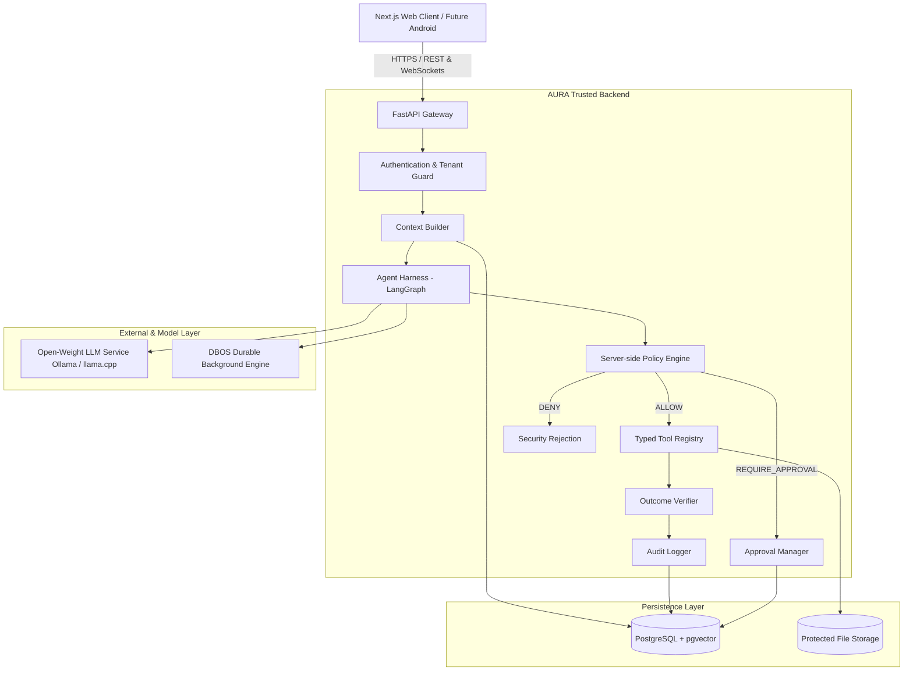

# AURA Architecture Overview

## 1. High-Level System Architecture

AURA is structured as a **secure modular monolith** in its backend, interfacing with an authenticated web client and external durable workers.

---

## 2. Controlled Agentic Request Flow

Every agentic user request follows a strict sequence of checks:

1. **Ingress & Authentication:** Request arrives at FastAPI. Token is verified; tenant ID is extracted into context.
2. **Context Construction:** Authorized conversation history, personal memories, and relevant RAG document chunks are retrieved from PostgreSQL/pgvector.
3. **Model Proposal:** The LLM receives the prompt and proposes a structured plan or typed tool call. **The LLM has zero execution authority.**
4. **Policy Enforcement:** The custom Policy Engine inspects the proposed tool and arguments.
   * *Safe/Read-only:* `ALLOW` -> proceeds to execution.
   * *Sensitive/State-mutating:* `REQUIRE_APPROVAL` -> creates a signed approval token and notifies the user.
   * *Disallowed/Unsafe:* `DENY` -> execution blocked and audit event logged.
5. **Execution & Observation:** The tool executes in an isolated environment.
6. **Outcome Verification:** An independent verifier checks whether the intended state change actually occurred.
7. **Persistence & Return:** Updated state and audit logs are committed; response returned to the user.
