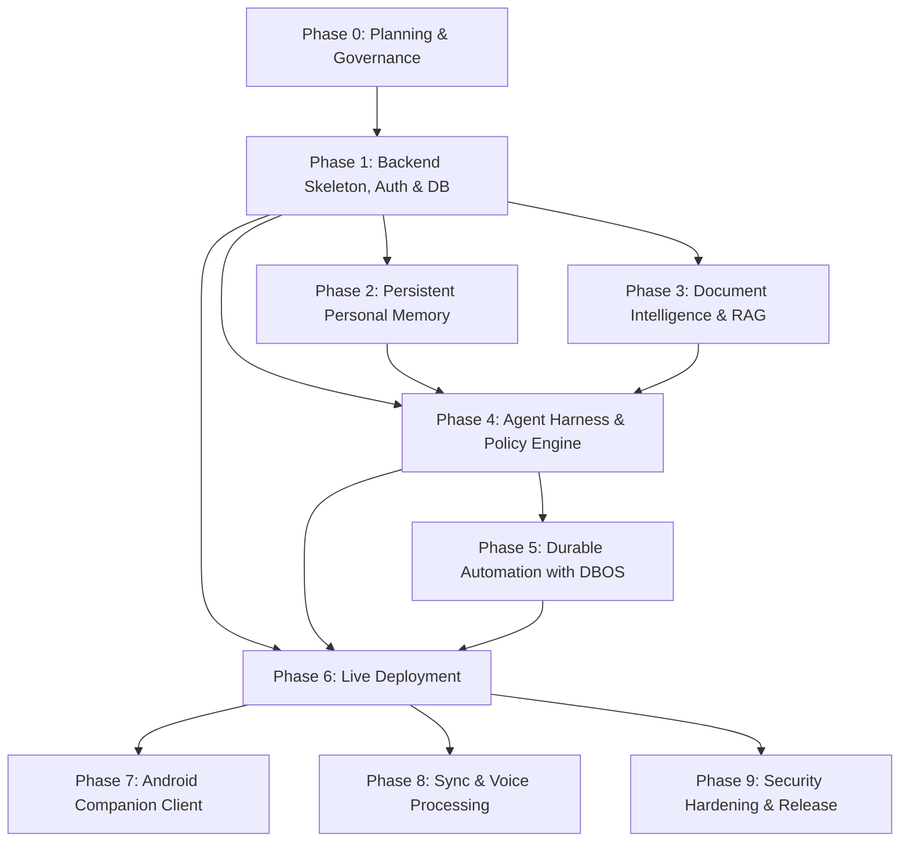

# AURA System Dependencies, Hardware Constraints, and Risk Register

## 1. Phase Dependency Graph

Implementation phases are strictly ordered by data and architectural dependencies:

* **Phase 1 is the prerequisite foundation:** Without relational users, session management, and tenant isolation, neither personal memory (Phase 2) nor uploaded documents (Phase 3) can enforce ownership security boundaries.
* **Phase 4 brings intelligence:** LangGraph and the custom Policy Engine unify conversational context, memories, and RAG document citations into structured, authorized agent actions.

---

## 2. Hardware Constraints & Execution Reality

| Hardware Dimension | Local Development Machine | Architectural Strategy |
| :--- | :--- | :--- |
| **CPU** | Intel Core i5-13420H (8 cores / 12 threads) | Handles async FastAPI services, SQLite/PostgreSQL in Docker, and test suites with low overhead. |
| **System RAM** | 16 GB | Sufficient for Dockerized Postgres with `pgvector`, Next.js dev server, and small quantized embeddings. |
| **GPU / VRAM** | NVIDIA RTX 2050 (4 GB VRAM) | **Local LLM constraint:** 4 GB VRAM cannot fit a 7B or 14B parameter model in FP16 or Q8. Local testing will prioritize 3B quantized models (e.g., `qwen2.5:3b-instruct-q4_K_M`) via Ollama/llama.cpp, with mocked providers for unit tests. |
| **Live Deployment** | Free-tier Cloud (e.g. Oracle Cloud VM) | Deployed models must match host architecture (e.g. ARM64 Ampere or CPU inference) without assuming local laptop GPU availability. |

---

## 3. Unresolved Decisions & Active Risk Register

| Risk / Decision ID | Description | Impact | Mitigation Plan |
| :--- | :--- | :--- | :--- |
| **RISK-001** | Open-weight LLM quality on complex tool calls on low-parameter models (<=3B) | Reduced agentic reasoning fidelity | Build strict Pydantic JSON schemas, explicit validation, and benchmark representative prompts against Ollama candidates in Phase 4. |
| **RISK-002** | DBOS Python SDK compatibility and durability guarantees | Background jobs failing to recover after worker crashes | Conduct isolated spike testing before finalizing DBOS in Phase 5; maintain Celery/Redis or APScheduler as fallback. |
| **RISK-003** | Cloud free-tier hosting reclamation or compute limits | Intermittent live application downtime | Design the infrastructure as a containerized Docker Compose stack capable of deploying to any VPS with zero code modifications. |
